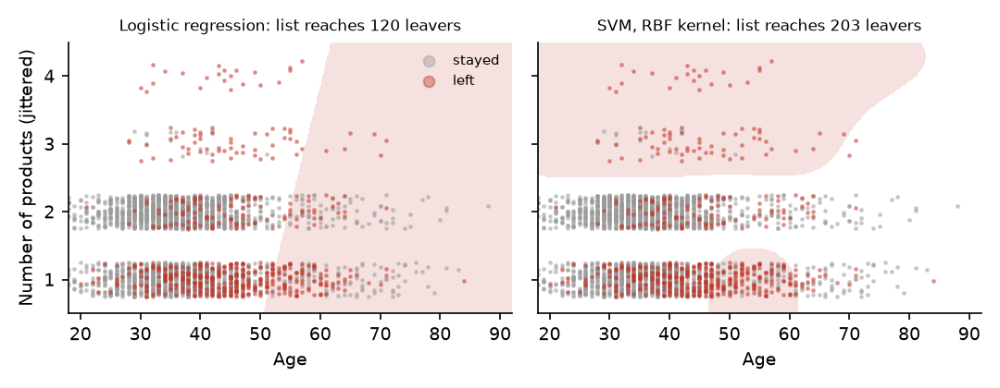
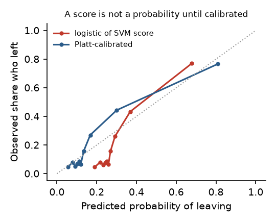

# Who should the retention team call?

In-class case for *Predictive Machine Learning in Finance* (IESE Master in Finance, November 2026). A European retail
bank loses one customer in five and its retention team can call 10% of them each quarter. Which model should build the
call list, and should it rank customers by how likely they are to leave or by how much money they would take with them?
Method: Support Vector Machines (linear, polynomial and RBF kernels) against a logistic regression. Data: Kaggle Churn
Modelling, 10,000 customers in France, Spain and Germany, downloaded with `kagglehub`.

**Short answer: use the RBF SVM; the boundary has to bend.** Churn rises with age up to 60 and then falls, and it is
lowest with two products and near-certain with three or four. A straight line cannot draw either shape. On the 3,000 test
customers a 300-name list built by the RBF SVM reaches 231 leavers (77% precision); a logistic regression reaches 162
and a random list about 61. Once calibrated, ranking by deposits at risk instead of probability reaches fewer leavers
(204) but more of their money (44% vs 38%). The one-page summary is in the [report](report/report.pdf).



## Results (test set: 3,000 customers, 611 leavers; call list = 300)

| Model | Leavers reached | Precision | Recall |
|---|---|---|---|
| Random list (expected) | 61 | 20.4% | 10.0% |
| Logistic regression | 162 | 54.0% | 26.5% |
| Linear SVM | 162 | 54.0% | 26.5% |
| SVM, polynomial kernel (degree 2) | 222 | 74.0% | 36.3% |
| SVM, RBF kernel | **231** | **77.0%** | **37.8%** |
| Logistic regression, age and products only | 120 | 40.0% | 19.6% |
| SVM RBF, age and products only | 203 | 67.7% | 33.2% |

- Share who left: 56% of customers aged 51-60 against 8% over 70; 7.6% with two products, 83% with three and 100% with
  four; 32% in Germany against 16-17% in France and Spain; 27% of inactive members against 14% of active ones.
- C × gamma grid: gamma = 1 overfits. With C = 10 the list reaches 49% of training leavers but only 26% in test. Small
  gammas give the same 38% in train and test.
- Passing the RBF score through a logistic function as if it were a probability gives an average of 30.1% against 20.4%
  real. Platt scaling brings it to 19.7%, and the call list is 99% the same: calibration changes the probabilities, not the
  ranking.

| Call list built on calibrated probabilities | Leavers reached | Share of the leavers' deposits reached |
|---|---|---|
| Ranked by probability of leaving | 230 | 37.5% |
| Ranked by deposits at risk (probability × balance) | 204 | **44.5%** |



## Design choices

- 70/30 split stratified on `Exited`, `random_state=0`, as the case sets. `RowNumber`, `CustomerId` and `Surname` are
  dropped.
- Numeric columns are standardised and `Geography` and `Gender` one-hot encoded inside a pipeline, so the scaler is fitted
  on training customers only.
- A model's call list is the 10% of customers with the highest decision score. SVM scores are not probabilities, which is
  why the deposits-at-risk list uses the Platt-calibrated model.

## Reproduce

```bash
uv sync
uv run python src/bank_churn_svm.py        # downloads the data, writes output/figures and output/tables
cd report && pdflatex report.tex
```
