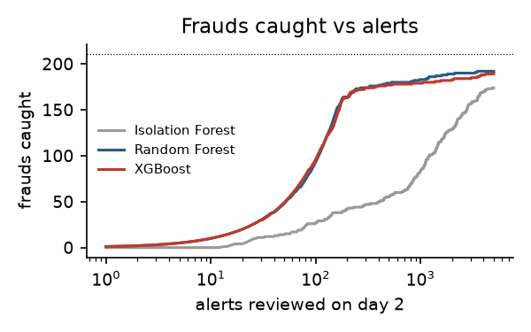

# Which transactions should the fraud team review?

In-class case for *Predictive Machine Learning in Finance* (IESE Master in Finance, November 2026). A card issuer's
fraud team can review a limited number of transactions a day, and fraud is confirmed weeks later, when the cardholder
disputes the charge. On the day a new pattern starts there are no labels. Which transactions should the team review,
does it pay, and how much are the labels worth once they arrive? Method: Isolation Forest (unsupervised) against
Random Forest and XGBoost (supervised, class-weighted). Data: Kaggle Credit Card Fraud Detection (ULB), 284,807
transactions over two days of September 2013, 492 frauds, downloaded with `kagglehub`. Every model is fitted on day 1
and judged on day 2.

**Short answer: without labels, review about 2,000 alerts a day; with labels, about 300.** Reviewing the 100 most
anomalous day-2 transactions finds 27 frauds, against 0.15 expected at random. At EUR 10 a review and EUR 500 a missed
fraud, the cost-optimal volume chosen on day 1 cuts the day-2 bill from EUR 105.5k to EUR 60.8k. Once the day-1 labels
arrive, XGBoost finds 96 frauds in its top 100 and the bill falls to about EUR 22k: the labels are worth roughly
EUR 40k a day. Unusual is not the same as fraudulent: the ten strangest transactions are all legitimate. The one-page
summary is in the [report](report/report.pdf).



## Results (day 2: 140,021 transactions, 211 frauds)

| Top 100 alerts | Frauds caught | Precision | Recall |
|---|---|---|---|
| Random list (expected) | 0.15 | 0.2% | 0.1% |
| Isolation Forest | 27 | 27% | 12.8% |
| Random Forest | 93 | 93% | 44.1% |
| XGBoost | **96** | **96%** | **45.5%** |

| Review cost EUR 10, N chosen on day 1 | Alerts a day | Frauds caught | Day-2 cost |
|---|---|---|---|
| Do nothing | 0 | 0 | EUR 105,500 |
| Isolation Forest | 2,180 | 133 | EUR 60,800 |
| Random Forest | 300 | 174 | EUR 21,500 |
| XGBoost | 340 | 174 | EUR 21,900 |

- 0.173% of transactions are fraud, so "everything is legitimate" scores 99.83% accuracy and catches nothing. Frauds
  are smaller (median EUR 9.25 vs EUR 22) and cluster at night: 1.7% of transactions at 2 a.m. are fraud.
- Isolation Forest needs 7.9 random splits on average to isolate a fraud and 13.0 for a legitimate transaction.
- Precision falls and recall rises as the team reviews more: 36% / 4% at 25 alerts, 6.4% / 61% at 2,000.
- The cheaper the review, the more it pays: the detector saves EUR 77k at EUR 2 a review (an SMS or 3-D Secure
  challenge) and only EUR 6.5k at EUR 50 (an analyst).
- Top alerts: median amount EUR 487, extreme on V20, V28 and V23. The frauds the detector does catch: median EUR 2.28,
  very negative on V7, V17, V3 and V10.

## Design choices

- `hour` assumes the file starts at midnight; `log_amount` = log(1 + Amount). Models use V1-V28 and `log_amount`,
  standardised with day-1 statistics.
- Isolation Forest: 200 trees, `random_state=42`, no labels. Random Forest (300 trees, balanced class weights) and
  XGBoost (`scale_pos_weight` = legitimate / fraud on day 1).
- The supervised models fit day 1 almost perfectly, so their cost-optimal N is chosen on 5-fold out-of-fold day-1
  scores, not on in-sample ones. N is searched in steps of 10 up to 5,000.

## Reproduce

```bash
uv sync
uv run python src/fraud.py        # downloads the data, writes output/figures and output/tables
cd report && pdflatex report.tex
```
