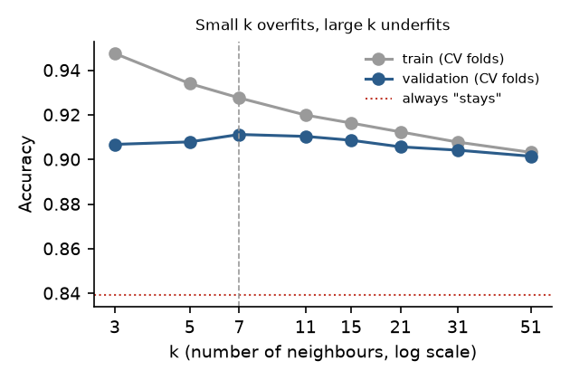
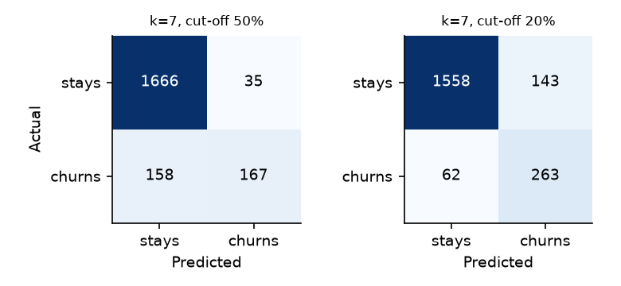

# Which cardholders are about to close their account?

In-class case for *Predictive Machine Learning in Finance* (IESE Master in Finance, November 2026). The bank wants to
find the credit card customers who will leave before they call to cancel. The method is K-Nearest Neighbours: a customer
is at risk if the customers most like them left. Data: Kaggle Credit Card Customers, 10,127 customers, downloaded with
`kagglehub`.

**Short answer: yes, but KNN only works once the distance means something.** 16.1% of customers churn, so "nobody
leaves" is already 84% accurate. The unscaled KNN looks good (89.1%) by accident: three dollar columns make up 99.6% of
the distance and they happen to be predictive. Scaling every column, dummies included, drops it to 85.8%. Scaling only the
numeric columns inside a pipeline and choosing k by cross-validation gives 90.5% accuracy and AUC 0.91, and lowering the
alarm to a 20% churn probability catches 81% of the churners. The one-page summary is in the [report](report/report.pdf).



## Results (test set: 2,026 customers, 325 churners)

| Model | Accuracy | Recall (churners caught) | Precision |
|---|---|---|---|
| Always "stays" | 84.0% | 0% | – |
| KNN k=5, unscaled | 89.1% | 55.1% | 70.5% |
| KNN k=5, StandardScaler on all 37 columns | 85.8% | 21.8% | 68.3% |
| Pipeline (scale numeric, one-hot categorical), k=7 | 90.5% | 51.4% | **82.7%** |
| Same pipeline, alarm at 20% | 89.9% | **80.9%** | 64.8% |
| Numeric columns only, k=11 | **91.2%** | 56.9% | 82.6% |

- The credit limit range is 33,111 times the utilisation range. Without scaling, `Credit_Limit` and `Avg_Open_To_Buy`
  (almost the same column) take 93% of the squared distance.
- Standardising the dummies backfires: a Platinum card holder (20 in the whole file) sits 21.8 standard deviations away
  from everyone else on that one column, so the rare dummy decides who is a neighbour.
- k=3 overfits (94.8% train vs 90.7% validation); from k=21 on, both lines fall together: underfitting.
- Curse of dimensionality: with uniform random points, the nearest-to-farthest distance ratio goes from 0.01 in 2
  dimensions to 0.52 in 37. Everyone becomes roughly equally far. Dropping the 23 dummy columns is the best model here.



## Design choices

- The two `Naive_Bayes_Classifier_...` columns are predictions of the target made with the target: dropped on load,
  together with the ID `CLIENTNUM`.
- 80/20 split stratified on churn, seed 42. Cross-validation is stratified 5-fold with shuffling.
- The final model is a `Pipeline` with a `ColumnTransformer` (StandardScaler on the 14 numeric columns, one-hot on the
  5 categorical ones), so scaling is learnt on training folds only. The script checks that it matches the manual steps.

## Reproduce

```bash
uv sync
uv run python src/churn_knn.py        # downloads the data, writes output/figures and output/tables
cd report && pdflatex report.tex
```
