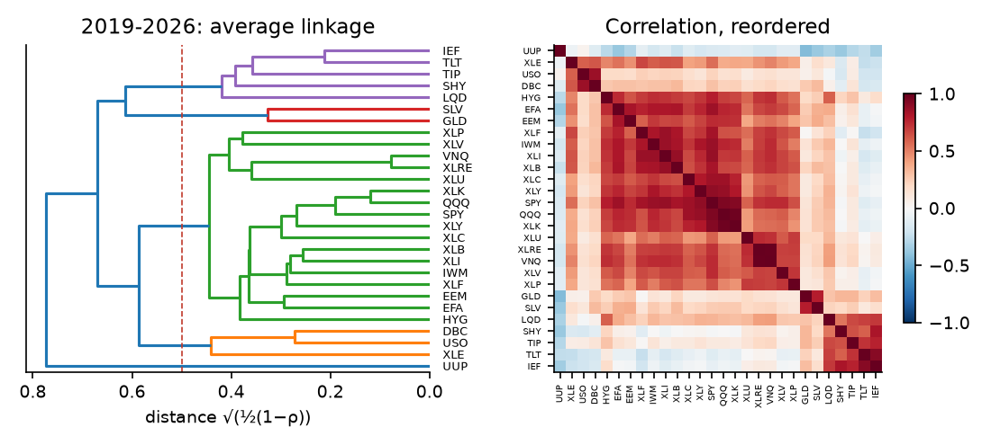

# How many segments, and how many bets?

In-class case for *Predictive Machine Learning in Finance* (IESE Master in Finance, November 2026). Two questions,
one tool. A retailer with 2,216 customers wants segments it can actually run, one strategy per group. A portfolio
manager holds 28 ETFs and wants to know whether they are 28 bets or a few bets with 28 names. Method: K-Means and
hierarchical (agglomerative) clustering. Data: Kaggle Customer Personality Analysis, downloaded with `kagglehub`, and
daily adjusted prices of the 28 ETFs from Yahoo Finance, January 2019 to September 2026.

**Short answer: four customer segments, and five real bets out of 28 ETFs.** K-Means and Ward give four segments
that tell a story (affluent big spenders, established households with teenagers, older families on a tight budget,
young low-income families) and agree on most customers (adjusted Rand 0.61). The other three linkages are useless for
segmenting, but they find the data errors: customers aged 122 to 129 and an income of $666,666. Ward's six segments
sit exactly inside its four; K-Means' do not. The ETFs collapse into equities with high yield, Treasuries with
investment-grade credit, energy and oil, precious metals, and the dollar. That map is not stable: the stock-bond
correlation went from −0.41 in 2019-2021 to +0.11 in 2022-2026. The one-page summary is in the
[report](report/report.pdf).



## Results

| K-Means, k = 4 | Customers | Age | Income | Spending (2 yrs) | Campaigns accepted | Web visits / month | Kids / teens |
|---|---|---|---|---|---|---|---|
| Affluent big spenders | 523 | 53 | $78k | $1,380 | 1.1 | 2.7 | 0.1 / 0.0 |
| Established, teenagers at home | 590 | 58 | $61k | $827 | 0.3 | 5.4 | 0.1 / 1.0 |
| Older families, tight budget | 523 | 59 | $41k | $120 | 0.1 | 6.0 | 0.7 / 1.0 |
| Young families, low income | 580 | 43 | $30k | $126 | 0.2 | 7.0 | 0.9 / 0.0 |

- Without scaling, distance is income: it ranges over $665k, the next widest feature over 2,520.
- Elbow: no clear kink. Silhouette is highest at k = 2 (0.27); k = 4 scores 0.21. Two segments ("rich and not rich")
  are too coarse to act on, so the business picks four.
- Hierarchical, cut at four clusters: single linkage gives 2,213 / 1 / 1 / 1, complete and average 2,203 / 9 / 3 / 1,
  Ward 748 / 503 / 487 / 478. The tiny clusters are three birth-year typos, the $666,666 income and nine households
  earning under $9k a year. Those linkages isolate the strangest points first; Ward minimises variance and builds
  balanced groups.
- Ward vs K-Means at k = 4: adjusted Rand 0.61; silhouette 0.18 vs 0.21. At six segments, 6 of 6 Ward segments sit
  inside one of its four; 1 of 6 K-Means segments does. With a million customers, hierarchical clustering needs
  5 × 10¹¹ pairwise distances (4 TB): K-Means scales, Ward does not.

| ETFs, average linkage, cut at distance 0.5 | Window | Bets | ρ(SPY, TLT) | Where TLT sits |
|---|---|---|---|---|
| Full sample | 2019-2026 | 5 | | Treasuries + TIP + LQD |
| Before the 2022 rate shock | 2019-2021 | 6 | −0.41 | Treasuries + TIP; LQD on its own |
| After | 2022-2026 | 6 | +0.11 | Treasuries + TIP + LQD |

High yield sits with equities (ρ SPY-HYG 0.78: default risk moves with the economy). Investment grade sits with
Treasuries (ρ LQD-IEF 0.71: it is mostly interest-rate risk). After 2022 defensive sectors and real estate split off
from the rest of equities, so the count stays at six while the bonds stop hedging.

## Design choices

- 24 customers without income are dropped, as the case sets; the outliers are kept, because finding them is Q4.
- The nine segmentation features are standardised. K-Means uses `n_init=10`, `random_state=42`.
- ETF distance is √(½(1 − ρ)) on daily returns. The case supplies `data/etf-prices.csv`; this repo does not
  redistribute it, so the script downloads the same series from Yahoo Finance when the file is missing.

## Reproduce

```bash
uv sync
uv run python src/segments.py        # downloads the data, writes output/figures and output/tables
cd report && pdflatex report.tex
```
