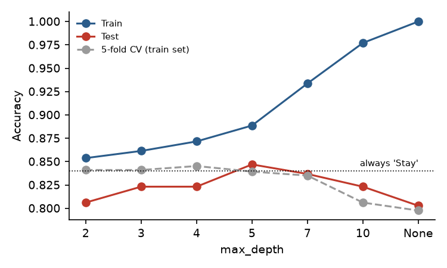
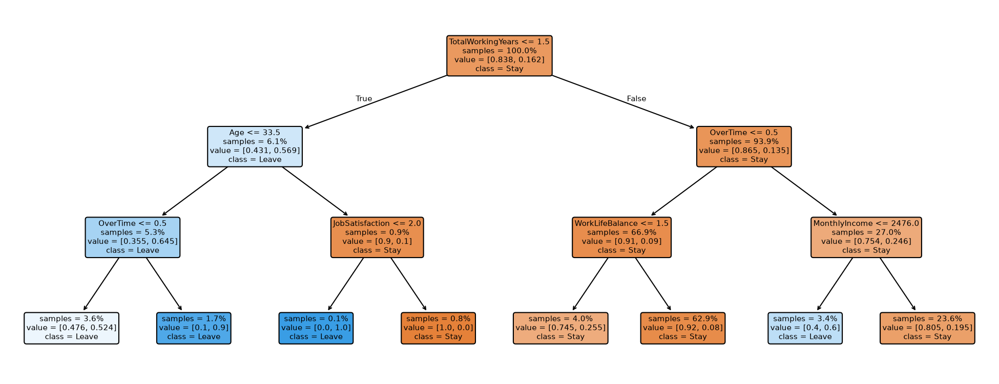

# Which employees are about to leave?

In-class case for *Predictive Machine Learning in Finance* (IESE Master in Finance, November 2026). HR wants to know
which employees are at risk of quitting and why, so it can target retention. Data: IBM HR Analytics, 1,470 employees,
35 columns, downloaded from Kaggle with `kagglehub`.

**Short answer: accuracy is the wrong yardstick here.** Only 16.1% of employees left, so "nobody leaves" is already 84%
accurate. The best decision tree (depth 5) scores 84.7% on the test set and 84.1% in 5-fold cross-validation: almost no
gain in accuracy, but it catches a third of the leavers and turns them into readable rules. A logistic regression on the
same features does better on every metric, and with the alarm lowered to a 25% probability it reaches 68% of leavers.
The one-page summary is in the [report](report/report.pdf).



## Results (test set: 294 employees, 47 leavers)

| Model | Accuracy | TP rate (recall) | FP rate | AUC |
|---|---|---|---|---|
| Always "Stay" | 84.0% | 0% | 0% | 0.50 |
| Decision tree, depth 5 | 84.7% | 34.0% | 5.7% | 0.67 |
| Logistic regression | **87.8%** | 40.4% | **3.2%** | **0.83** |
| Logistic regression, alarm at 25% | 82.7% | **68.1%** | 14.6% | 0.83 |

- Overfitting is visible from depth 5 on: an unlimited tree has 151 leaves and 100% train accuracy, 80.3% test.
- "Depth 5 is optimal" is fragile. Re-drawing the 80/20 split with 50 seeds, depth 2 or 3 wins 34 times and depth 5
  only 8. Cross-validated accuracy is flat between depths 2 and 5.
- The tree leans on total working years, overtime, monthly income and age. The depth-3 tree gives two clear rules:
  first-job employees under 34 who do overtime leave 90% of the time; overtime plus monthly income at or below $2,476
  means 60%.



## Design choices

- Constant columns (`EmployeeCount`, `Over18`, `StandardHours`) and the ID `EmployeeNumber` are dropped.
- Ordinal integer codes (satisfaction scores, `JobLevel`, `StockOptionLevel`) are kept as numbers: a tree only uses
  them through thresholds, so the order is all that matters. `OverTime` is 0/1, `BusinessTravel` is coded 0/1/2 because
  it is ordered, and `MaritalStatus` and `Department` are one-hot encoded.
- 80/20 split stratified on the target, seed 42. Cross-validation is stratified 5-fold with shuffling.
- The logistic regression is standardized inside a pipeline, so the scaler is fitted on training folds only.

## Reproduce

```bash
uv sync
uv run python src/attrition.py        # downloads the data, writes output/figures and output/tables
cd report && pdflatex report.tex
```
