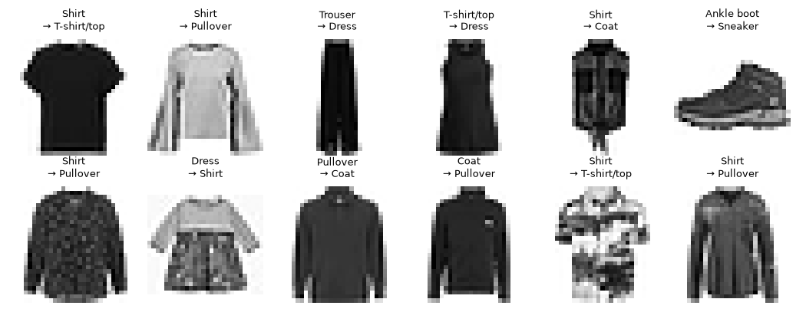

# Does respecting the image pay? CNNs on a fashion catalogue

In-class case for *Predictive Machine Learning in Finance* (IESE Master in Finance, November 2026), the afternoon
follow-up to [fashion-mlp-case](../fashion-mlp-case). The perceptron flattens each 28 × 28 photo into 784 numbers, so
a pixel has no neighbours, and it stops at 87%. How much does an architecture that keeps the 2-D structure add? Method:
a dense Keras baseline against convolutional neural networks (Keras 3 on TensorFlow, CPU). Data: Fashion-MNIST (Zalando
Research), 60,000 training and 10,000 test images in 10 classes, loaded with `keras.datasets`.

**Short answer: about 3.7 points from the case's CNN, and 6.3 from a deeper one.** The dense network 784-32-32-10
reaches 86.3% after 10 epochs. The case's CNN (two convolution and pooling stages, then a dense layer) reaches 90.0%
after 5 epochs, which removes over a quarter of the errors. A deeper CNN with batch normalisation and dropout reaches
92.6% after 12 epochs. Shirts stay the hard class: 63% right, against 98% for sneakers. The one-page summary is in the
[report](report/report.pdf).



## Results (test set: 10,000 images)

| Model | Parameters | Epochs | Train | Test | CPU time |
|---|---|---|---|---|---|
| Dense 784-32-32-10 | 26,506 | 10 | 89.3% | 86.3% | 43 s |
| CNN of the case | 121,930 | 5 | 92.6% | 90.0% | 125 s |
| Deeper CNN (2 × [conv, BN, conv, BN, pool, dropout], dense 128) | 468,586 | 12 | 95.3% | **92.6%** | 810 s |

- Calling `fit()` again without rebuilding the model continues training from the current weights: after 10, 20 and
  30 epochs the dense network scores 89.3 / 90.5 / 91.2% on train and 86.3 / 86.7 / 86.8% on test. scikit-learn's
  `fit()` starts from scratch each time (unless `warm_start=True`).
- CNN parameters: Conv2D 32 filters 320, Conv2D 64 filters 18,496, Dense 64 102,464, Dense 10 650. Weight sharing keeps
  the convolutions cheap; 84% of the parameters sit in the first dense layer after flattening.
- The CNN makes 1,002 errors. Accuracy by class: shirt 62.9%, coat 81.8%, T-shirt 86.6%, pullover 88.2%; sneaker 98.4%,
  bag 97.8%.

## Design choices

- Pixels divided by 255. Adam, sparse categorical cross-entropy, batch 32 (64 for the deeper CNN); the CNNs hold out
  10% of the training images for validation.
- `keras.utils.set_random_seed(42)`. TensorFlow on CPU is not bit-for-bit deterministic across machines, so accuracies
  can move by a few tenths.
- CPU time is wall-clock seconds on a 22-thread laptop CPU, one model at a time, no GPU, so it compares with the
  perceptron case.

## Reproduce

```bash
uv sync
uv run python src/fashion_cnn.py        # downloads the data, writes output/figures and output/tables
cd report && pdflatex report.tex
```
