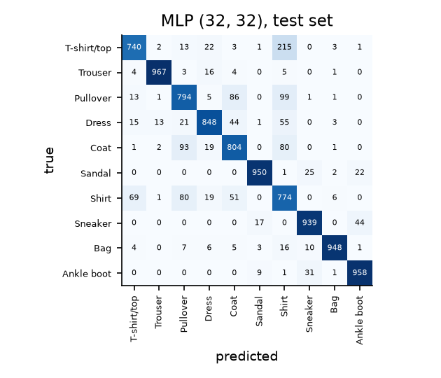

# Can a perceptron tag a fashion catalogue?

In-class case for *Predictive Machine Learning in Finance* (IESE Master in Finance, November 2026). An online fashion
platform must tag millions of product photos a day into categories (T-shirt, dress, sneaker...). Can a neural network do
it, and which preprocessing and architecture choices matter? Method: multi-layer perceptrons (scikit-learn
`MLPClassifier`) on flattened images. Data: Fashion-MNIST (Zalando Research), 60,000 training and 10,000 test images of
28 × 28 grey pixels in 10 balanced classes, loaded with `keras.datasets`. The follow-up with convolutional networks is
in [fashion-cnn-case](../fashion-cnn-case).

**Short answer: yes, to 87%, and the decisive step is dividing the pixels by 255.** The same tiny (2, 2) network goes
from 31.6% test accuracy on raw 0-255 pixels to 72.7% on 0-1 pixels; a (32, 32) network reaches 87.2%. What it gets
wrong is what a person would: T-shirts, shirts, pullovers and coats share a silhouette. Binarising the input costs
3 points and trains 2.5 times faster, a toy version of the quantisation used to run large language models
cheaply. The one-page summary is in the [report](report/report.pdf).



## Results (test set: 10,000 images)

| Network (hidden layers) | Input | Parameters | Train | Test | CPU time |
|---|---|---|---|---|---|
| (2, 2) | raw pixels 0-255 | 1,606 | 31.9% | 31.6% | 12 s |
| (2, 2) | pixels / 255 | 1,606 | 74.0% | 72.7% | 16 s |
| (16) | pixels / 255 | 12,730 | 89.4% | 86.0% | 28 s |
| (16, 2) | pixels / 255 | 12,624 | 85.9% | 82.8% | 47 s |
| (32, 32) | pixels / 255 | 26,506 | 92.5% | **87.2%** | 122 s |
| (32, 32) | binary (pixel > 0.3) | 26,506 | 92.9% | 84.0% | 48 s |

- Starting weights are drawn within ±0.086. On raw pixels a neuron's first sum averages 116 in absolute value; on
  pixels / 255 it averages 0.45. With inputs that large, ReLUs saturate or die and the gradients are useless.
- (16, 2) is a bottleneck: everything the 16 neurons learn has to pass through 2 numbers to choose among 10 classes,
  so it scores 82.8% against 86.0% for (16) alone, with the same number of parameters.
- Parameters of (32, 32): 784 × 32 + 32 = 25,120, then 32 × 32 + 32 = 1,056, then 32 × 10 + 10 = 330; 26,506 in all,
  95% of them in the first layer.
- Most confused (true → predicted): T-shirt → Shirt 215, Pullover → Shirt 99, Coat → Pullover 93, Pullover → Coat 86.
  Best classes: Trouser 96.7%, Ankle boot 95.8%; worst: T-shirt 74.0%, Shirt 77.4%.

## Design choices

- `MLPClassifier` defaults (ReLU, Adam, batch 200) with `max_iter=60` and `random_state=42`. Every model stops at 60
  epochs, so accuracies compare networks trained for the same number of passes.
- Binarised input: pixel / 255 > 0.3 → 1, else 0.
- CPU time is wall-clock seconds for 60 epochs on a 22-thread laptop CPU, one model at a time. It depends on the
  machine; the ratios are what matter.

## Reproduce

```bash
uv sync
uv run python src/fashion_mlp.py        # downloads the data, writes output/figures and output/tables
cd report && pdflatex report.tex
```
