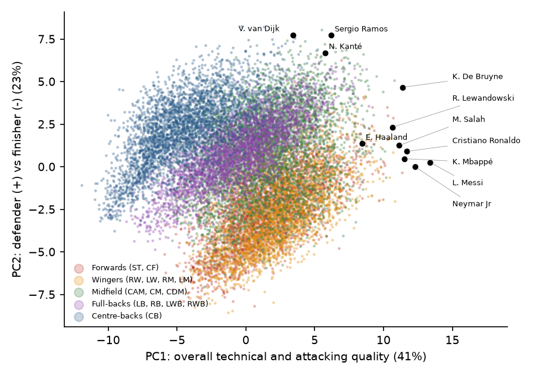
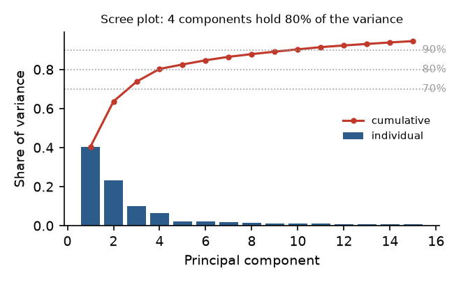

# How many real dimensions hide in 35 football skills?

In-class case for *Predictive Machine Learning in Finance* (IESE Master in Finance, November 2026). EA Sports rates every
professional footballer on 35 skills. They are strongly correlated, so the question is how many independent dimensions
they really contain and what those dimensions mean. Method: Principal Component Analysis, unsupervised. Data: Kaggle
FIFA 22 Complete Player Dataset, 19,239 players (17,107 once goalkeepers are set aside), downloaded with `kagglehub`.

**Short answer: about four.** Three components explain 74% of the variance of the 35 standardised skills, four explain
80% and ten explain 90%. They have clear football meanings: overall technical and attacking quality (41%), defender vs
fast finisher (23%), and light and quick vs big and strong (10%). Positions separate on their own in that space, and the
players closest to Messi are Neymar, Dybala, Mbappé, Salah and Son. The one-page summary is in the
[report](report/report.pdf).



## Results (17,107 outfield players, 35 skills)

| Component | Variance explained | Cumulative | High (+) | Low (−) |
|---|---|---|---|---|
| PC1 | 40.6% | 40.6% | dribbling, shooting, long shots, ball control | (defending, only slightly) |
| PC2 | 23.2% | 63.8% | defending, interceptions, marking, tackling | acceleration, pace, finishing |
| PC3 | 10.1% | 73.9% | acceleration, balance, pace, agility | heading, strength, penalties, shot power |

- Position centroids in (PC1, PC2): centre-backs (−4.6, 2.2), defensive midfielders (−0.1, 2.3), right wingers
  (2.3, −3.0), strikers (1.5, −2.6). Stars sit far out on PC1: Messi 13.4, Neymar 12.3, Cristiano Ronaldo 11.7.
- Predicting the position group (5 classes) with a logistic regression: 87.0% cross-validated accuracy with all 35
  skills, 77.4% with 4 PCs, 84.8% with 10. Fewer PCs mean a simpler, more stable model at a cost in accuracy.
- Closest to Messi with 3 PCs: Neymar, Mbappé, Dybala, Salah, Son, Cristiano Ronaldo. With 4 PCs Mbappé and Ronaldo
  drop out of the top eight; Hazard moves up and Di María comes in.



## Design choices

- The 35 skills are the six summary ratings plus the 29 `attacking_`, `skill_`, `movement_`, `power_`, `mentality_` and
  `defending_` attributes. `skill_moves` (a 1-5 star rating) is excluded.
- Goalkeepers (first listed position starts with `GK`) are dropped: their skill profile is a different
  game. The primary position is the first one listed.
- Skills are standardised before PCA. Component signs are fixed so that PC1 rises with quality, PC2 with defending and
  PC3 with lightness, which keeps the reading stable across runs.

## Reproduce

```bash
uv sync
uv run python src/fifa_pca.py        # downloads the data, writes output/figures and output/tables
cd report && pdflatex report.tex
```
