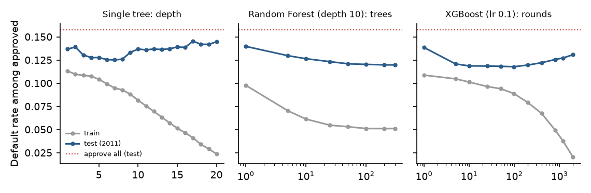
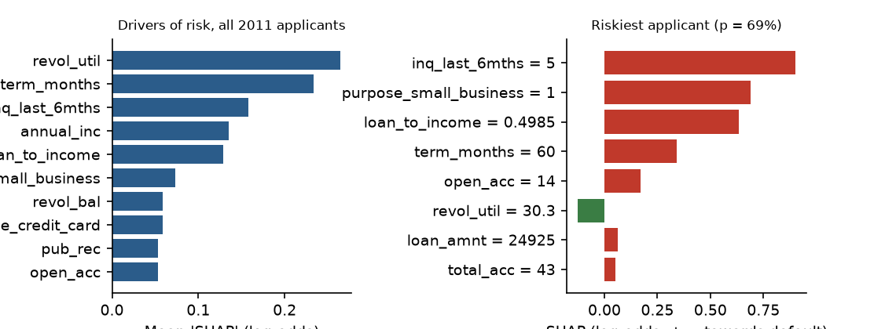

# Lending Club: who gets the loan?

In-class case for *Predictive Machine Learning in Finance* (IESE Master in Finance, November 2026). A consumer lender
approves the 80% of applicants with the lowest predicted risk and declines the rest. A model is worth what it does to
the loan book, so every model is judged on the default rate among the loans it approves. Methods: a decision tree,
Random Forest and XGBoost, explained with SHAP. Data: Kaggle Lending Club 2007-2011, 38,770 loans with a known outcome,
downloaded with `kagglehub`. Train on loans issued up to December 2010, test on 2011.

**Short answer: decline by XGBoost and the 2011 book goes from 15.8% defaults to 11.8%.** Expected losses fall from
$12.3M to $8.3M per $100M lent, at the cost of turning away 2,831 good borrowers to avoid 1,311 defaults. That beats a
single tree (12.6%) and Lending Club's own grade (12.4%), using only what is known on the day of the application. A
tree that also sees the repayment columns gets 0.5%, which is leakage, not skill. The one-page summary is in the
[report](report/report.pdf).



## Results (2011 test loans: 20,708, default rate 15.8%; approve 80%)

| Policy | Default rate among approved | Loss per $100M lent | Defaults avoided | Good borrowers turned away |
|---|---|---|---|---|
| Approve everybody | 15.8% | $12.3M | 0 | 0 |
| Decline 20% at random | 15.8% | $12.3M | 624 | 3,518 |
| Decision tree, depth 6 | 12.6% | $9.4M | 1,183 | 2,959 |
| Lending Club sub-grade | 12.4% | $8.9M | 1,203 | 2,939 |
| Random Forest, 300 trees, depth 10 | 12.0% | $8.5M | 1,278 | 2,864 |
| XGBoost, learning rate 0.1, 99 trees | **11.8%** | **$8.3M** | **1,311** | **2,831** |

- Leakage: with `total_pymnt`, `total_rec_prncp`, `recoveries`, `last_pymnt_amnt` and `collection_recovery_fee` the
  depth-6 tree reaches 0.48% (AUC 0.99), and `recoveries` alone takes 74% of the importance. Those columns only exist
  after the loan has gone bad.
- Depth drives overfitting. An unconstrained tree has 2,393 leaves, 0.0% on its own training loans and 14.6% in 2011.
  More trees in a forest only remove noise: at depth 15, going from 5 to 300 trees takes the test rate from 13.7% to
  12.3%. Boosting does overfit with rounds: 11.8% at about 100, 13.1% at 2,000.
- Smaller learning rates need more trees for a slightly better result: 20 trees at 0.3 (12.1%), 99 at 0.1 (11.8%),
  343 at 0.03 (11.7%).
- SHAP drivers: revolving utilisation, term, credit inquiries, income and loan-to-income. The riskiest 2011 applicant
  (predicted 70% default) had 5 inquiries in six months, a small-business loan worth half their income, on 60 months.
- Reverse-engineering Lending Club's interest rate from application data: XGBoost MAE 2.13 points against 3.40 for the
  training mean. Not perfectly, because the grade draws on more than these columns and because the rate grid moved
  over time (average rate 11.79% in the training years, 12.08% in 2011).



## Design choices

- Only `Fully Paid` (0) and `Charged Off` (1) loans are kept; current loans and those under the old credit policy are
  dropped.
- Features are what the lender knows on the application day: amount, term, purpose, employment length, home ownership,
  income and its verification, DTI and the credit-bureau file, plus `credit_history_years` and `loan_to_income`.
  Lending Club's own decision (`grade`, `int_rate`, `installment`, funded amounts) is left out so the model is an
  independent second opinion; the sub-grade is used as a benchmark instead. `zip_code` and `addr_state` are excluded
  under fair-lending rules, free-text fields are not used.
- The 2011 test year never chooses anything: XGBoost's number of trees is set by early stopping on the second half of
  2010, then refitted on all training loans. Missing values are filled with training medians.
- Expected loss assumes exposure at default = loan amount and LGD = 70%.

## Reproduce

```bash
uv sync
uv run python src/lending.py        # downloads the data, writes output/figures and output/tables (~30 min)
cd report && pdflatex report.tex
```
