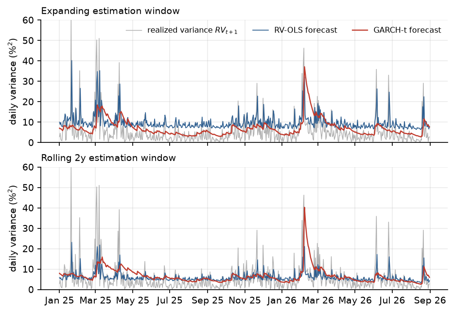
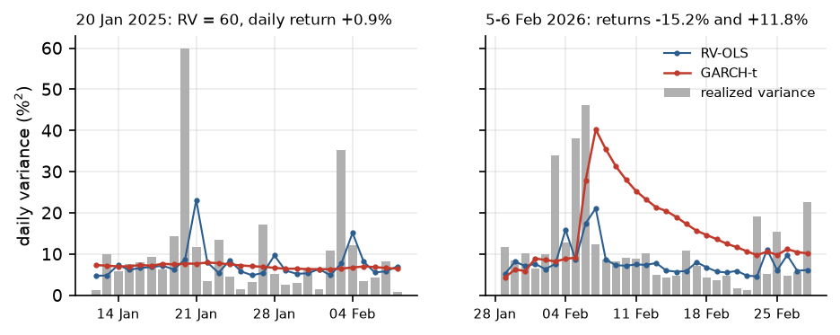

# How predictable is tomorrow's Bitcoin volatility?

Take-home case for *Predictive Statistics in Finance* (IESE Master in Finance, October 2026). A digital-asset fund's
portfolio manager must decide how much Bitcoin risk to carry tomorrow: which volatility forecast should the risk team
actually use?

**Short answer: the risk is partly predictable, and the information set matters more than the model.** Volatility
clusters and Student-t GARCH fits it far better than Normal GARCH (ν ≈ 3). Out of sample (608 days, Jan 2025 to Aug
2026), every rule estimated on all history over-forecasts risk by 30-80%, because Bitcoin's volatility today is a
fraction of 2017-2018's. Re-estimated on the last two years, a one-line regression of tomorrow's realized variance on
today's is the best-calibrated and most accurate rule. The full argument is in the [report](report/report.pdf).



## Results

| Rule (re-estimated daily) | MSE | QLIKE | Corr | Mean forecast / mean RV |
|---|---|---|---|---|
| GARCH(1,1)-t, expanding | 48.7 | 2.612 | 0.33 | 1.32 |
| RV-OLS, expanding | 58.1 | 2.753 | 0.43 | 1.82 |
| GARCH(1,1)-t, rolling 2 years | 47.0 | 2.615 | 0.29 | 1.23 |
| RV-OLS, rolling 2 years | **39.0** | **2.590** | 0.42 | **1.11** |

- With all history, RV-OLS has the highest correlation and the worst losses: its long-run mean (16) is three times the
  2025-2026 level (5.4). A two-year window cuts its MSE by a third (Diebold-Mariano t ≈ -8).
- GARCH-t persistence α+β sits at 1.000 on the full sample: the classic symptom of a drifting variance level. Because it
  barely uses a long-run mean, the window hardly affects it.
- The 2017-2018 realized variance is 1.4-1.7 times the squared daily returns; since 2019 the ratio is about 1. Old data
  are partly worse data.



## Design choices

- Returns are calendar-daily (Bitcoin trades every day); a forecast for day t+1 uses information up to t only.
- Both rules are re-estimated at each of the 608 origins; the rolling window is the last two calendar years, so the
  first forecast (1 Jan 2025) uses 1 Jan 2023 to 31 Dec 2024.
- RV-OLS uses only pairs of days that both have a valid 24-hour RV.
- Newey-West standard errors with 7 lags (one week); the CI for α+β uses the joint covariance of α and β.
- Forecast comparisons add Mincer-Zarnowitz calibration slopes and Diebold-Mariano tests to the MSE, QLIKE and
  correlation that the case asks for.

## Reproduce

Place the case files at `data/bitcoin_daily_prices.csv` and `data/bitcoin_realized_variance.csv`, then:

```bash
uv sync
cd src
uv run python task1.py      # Part I: descriptives, ACF, Ljung-Box, ARCH-LM
uv run python task2_3.py    # Parts II-III: ARCH, GARCH Normal and Student-t
uv run python forecast.py   # all 608 x 5 out-of-sample forecasts (~30 s)
uv run python evaluate.py   # Parts IV-VI: scores, DM tests, rolling stability
uv run python figures.py
cd ../report && pdflatex report.tex && pdflatex report.tex
```

Python 3.13 with pandas, statsmodels, arch and matplotlib.
