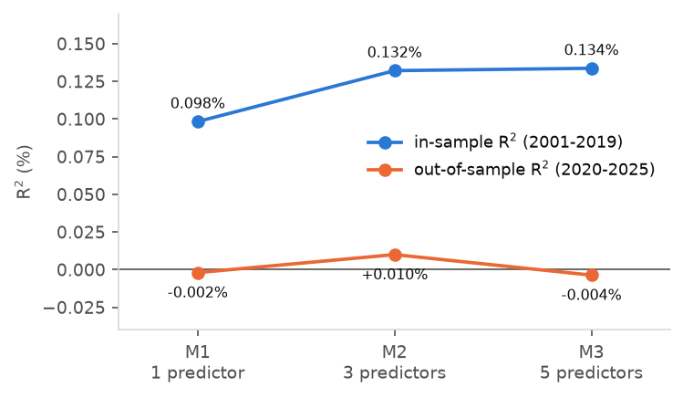
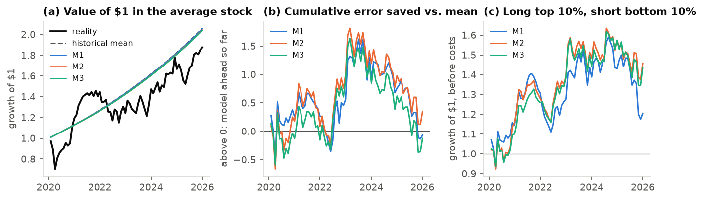

# Can we predict stock returns?

Take-home case for *Predictive Statistics in Finance* (IESE Master in Finance, October 2026). The question from the
investment committee: do observable stock characteristics help forecast next month's return on data the model has
never seen?

**Short answer: no, not the level of returns.** Five classic signals (last month's return, 12-2 momentum, size,
volatility, turnover) are statistically significant in 2001-2019 but explain about 0.13% of next-month returns.
Frozen at the end of 2019, no model beats the historical mean over 2020-2025, and giving each stock its own intercept
makes forecasts 5% worse. The full argument is in the [report](report/report.pdf).





## Results

| Model | Signals | In-sample R² (2001-2019) | Out-of-sample R² (2020-2025) |
|---|---|---|---|
| Historical mean | 0 | n/a | 0 |
| M1: current return | 1 | 0.098% | -0.002% |
| M2: + momentum, size | 3 | 0.132% | +0.010% |
| M3: + volatility, turnover | 5 | 0.134% | -0.004% |
| M3 with stock fixed effects | 5 + 7,823 intercepts | 2.929% | -4.96% (stocks seen in training) |

The failure is mostly instability rather than classic overfitting: re-estimated on 2020-2025, reversal and size
halve and volatility flips sign. The models still rank stocks a little (top minus bottom forecast decile, about
1 point a month before costs), which is a separate question from forecasting return levels.

## Design choices

- Every shift is done on a calendar grid (stock x month), never by row order: 14,602 gaps would otherwise create
  false next-month targets.
- The train/test split uses the month the target is realised, so the forecast made in December 2019 for January
  2020 is in the test sample.
- Momentum requires all 11 months from t-12 to t-2; volatility requires 8 of the last 12.
- Predictors are monthly cross-sectional percentile ranks; M1-M3 use exactly the same complete-case rows.
- Pooled OLS uses HC1 standard errors. The 2020-2025 data are never used to choose a model.

## Reproduce

The data are a CRSP monthly stock file from WRDS (licensed, not included). Place it at
`data/US_Stocks_PanelDataset.csv`, then:

```bash
uv sync
uv run python src/features.py        # target, predictors, ranks, split
cd src
uv run python task2.py               # simple predictive regression
uv run python task3.py               # M1-M3 in sample
uv run python task4.py               # out-of-sample test
uv run python diagnostic_coef_stability.py
uv run python task5.py               # stock fixed effects
uv run python figures.py             # all figures in output/figures/
cd ../report && pdflatex report.tex && pdflatex report.tex
```

Python 3.13 with pandas, NumPy, statsmodels and matplotlib.
